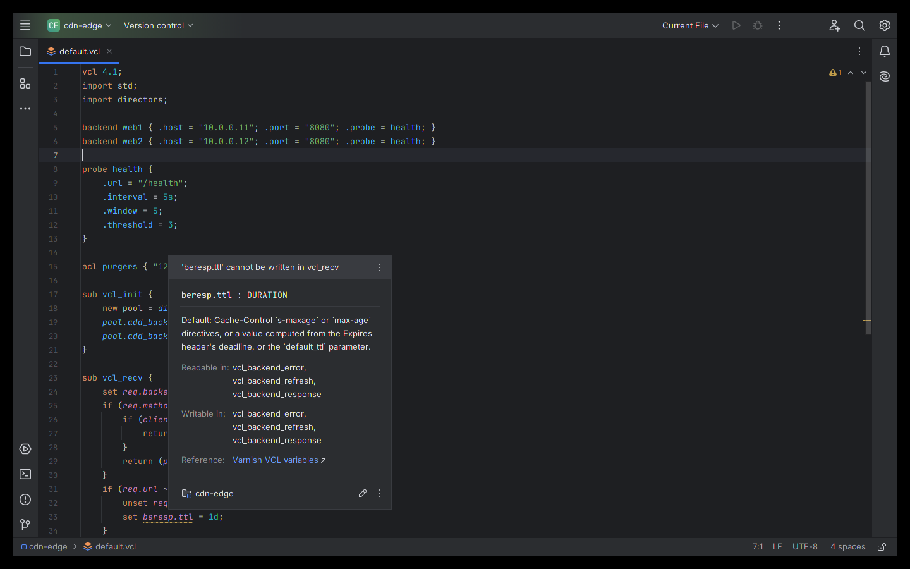
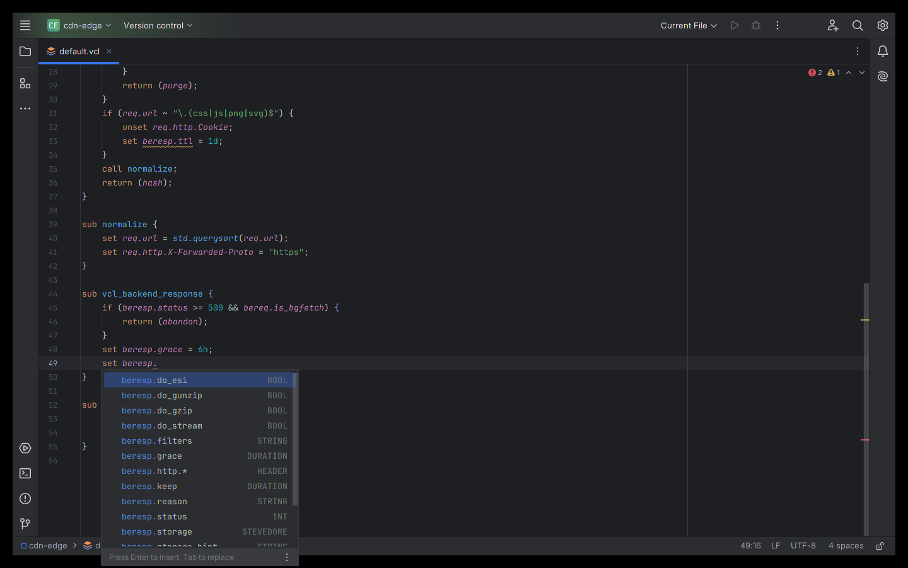

# VCL Language Tools — JetBrains IDE plugin

Language support for **VCL**, the configuration language of the **Varnish Cache** HTTP accelerator and of **Fastly**
custom VCL, in IntelliJ IDEA, PyCharm, GoLand, WebStorm, PhpStorm and every other JetBrains IDE (2024.3 and newer).

Install: *Settings → Plugins → Marketplace → search "VCL Language Tools"*.

## Features
- Syntax highlighting: keywords, built-in variables, functions, declarations, return actions, long strings `{"..."}`,
  durations, inline C (colors under *Settings → Editor → Color Scheme → VCL*)
- Dialect-aware: Varnish (files with `vcl 4.x;`) and Fastly VCL are detected automatically
- Completion: variables readable/writable in the current subroutine, VMOD and Fastly functions, return actions per
  built-in subroutine, subroutine names after `call`, backend/probe properties, declared backends, ACLs and tables
- Go to declaration, find usages and rename for subroutines, backends, ACLs, probes, tables, directors, `new` objects
  and local variables — across all VCL files of the project (works with `include`)
- Inspections: variables read/written/unset where Varnish does not allow it, invalid `return(...)` actions, undefined
  subroutines and symbols, missing `import` (quick fix), unknown variables, duplicate and unused declarations
- Quick documentation (Ctrl+Q / F1) for variables, functions and built-in subroutines
- Structure view, folding, brace matching, commenting

Tested against the VCL in Varnish Cache's own test suite (~780 files) and the Fastly examples of the falco project.

## More Klardaten plugins

- [HAProxy Config](https://github.com/klardaten-dev/haproxy-config) — HAProxy configuration: completion, navigation, 6 inspections, docs from the HAProxy manuals
- [Puppet Manifest Tools](https://github.com/klardaten-dev/puppet-manifest-tools) — Puppet manifests: Puppet 8 legacy-fact fixer, attribute checks, completion
- [PromQL and Prometheus Rules](https://github.com/klardaten-dev/promql-tools) — PromQL inside .promql and Prometheus rule files, checked like Prometheus itself
- [DNS Zone File Tools](https://github.com/klardaten-dev/dns-zone-tools) — BIND-style zone files: 70+ record types, trailing-dot, CNAME, SPF/DMARC checks

## Source code
The plugin is closed source (free to use under the EULA); this repository hosts its documentation, license and issue tracker. The source code is not public.

## Support
Please open an [issue](../../issues) for bugs and feature requests. Include your IDE version and a minimal VCL
snippet (remove secrets and internal host names first).

## Privacy
The plugin works fully offline and collects no data. See [PRIVACY.md](PRIVACY.md).

## License
Free to use under the [End User License Agreement](EULA.md). Third-party data notices: Varnish Cache documentation
(BSD-2-Clause) and Fastly VCL metadata (MIT), shipped in the plugin as `META-INF/NOTICE.txt`.

---
Independent project, not affiliated with or endorsed by Varnish Software or Fastly. Varnish and Fastly are trademarks
of their respective owners. JetBrains and IntelliJ are trademarks of JetBrains s.r.o.
